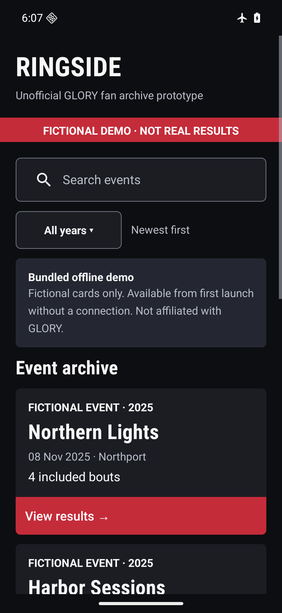
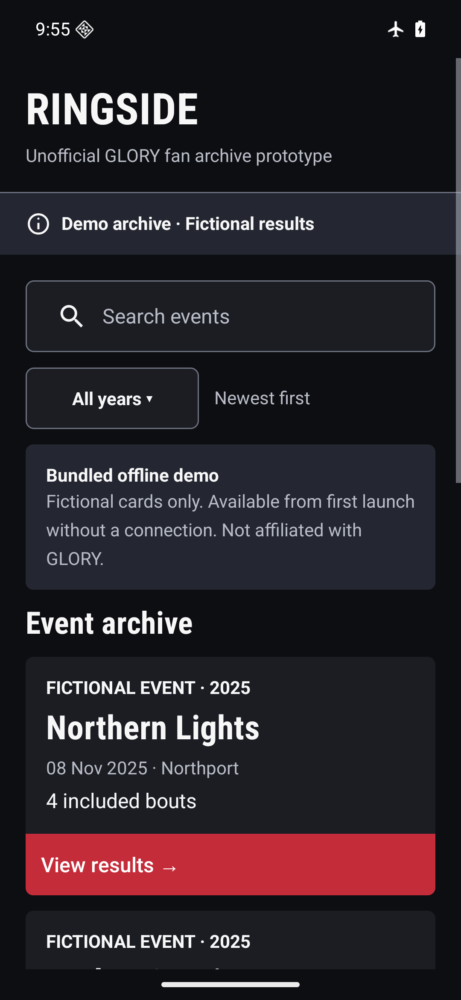
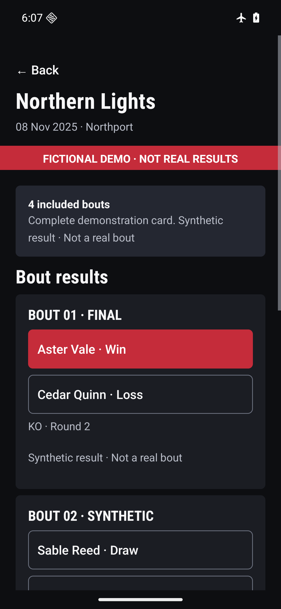
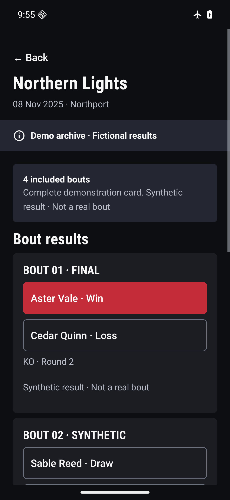
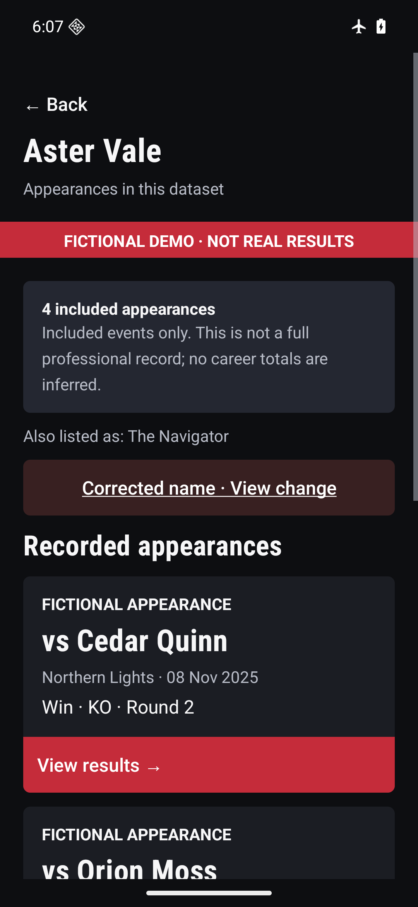
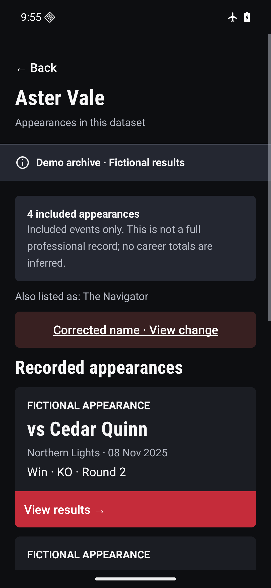

# Neutral demo notice

The red top banner looked like an error. The shared archive, event and fighter
shell now uses the existing charcoal notice surface (`#242731`), readable
`#F7F7F8` text and an original geometric information icon beside
**Demo archive · Fictional results**. The divider is neutral too. Red action
buttons and all other Dark Arena components remain unchanged.

The icon is a decorative compound drawable: the adjacent text supplies one
accessible label, with no duplicate icon announcement, error, click or live-alert
semantics. Text remains 14sp, wraps and grows in a `wrap_content` notice with
48dp minimum height and vertical padding. Text and icon contrast is 13.92:1.
The fictional-data distinction also remains in event cards, results, coverage
and provenance. No data, updater, package/version, listing or Play release changes.

## Actual before and after captures

Before: API36 run `run-96884fd79255`, source `1688318`; its entire app tree equals
the base `b753e9f`. After: API36 run `run-54a9524c4d32`, code `6f40533`.
All images are unedited device captures at 360dp portrait width.

| Screen | Before | After |
| --- | --- | --- |
| Archive |  |  |
| Event |  |  |
| Fighter |  |  |

| 200% text | Portrait | Landscape at top |
| --- | --- | --- |
| Archive | [Capture](screenshots/demo-notice/after/large-font-portrait.png) | [Capture](screenshots/demo-notice/after/large-font-landscape-before-scroll.png) |
| Event | [Capture](screenshots/demo-notice/after/large-event-portrait.png) | [Capture](screenshots/demo-notice/after/large-event-landscape-top.png) |
| Fighter | [Capture](screenshots/demo-notice/after/large-fighter-portrait.png) | [Capture](screenshots/demo-notice/after/large-fighter-landscape-top.png) |

## Verification

30 Python data-contract tests, 63 JVM tests, unsigned APK/AAB build, lint and
instrumentation compilation PASS. Lint: 0 errors, 3 existing warnings
(`GradleDependency`, `MergeRootFrame`, `UselessParent`).

47/47 local API36 ARM64 device cases PASS, including one added check of notice
colors/icon/accessibility semantics on all three screens and the existing
200% portrait/landscape layout, navigation, search, offline and data-update
refusal cases. Nine after captures were visually inspected: the notice wraps
without clipping or horizontal overflow; red result actions remain visible.
The new run reset this task's demo app data in airplane mode; the app was already
installed with the same test identity, so this is not a fresh-install claim.

Only the existing approved Glory test key and isolated emulator ADB identity
were used. Identity metadata stayed unchanged; font scale restored to 1.0,
density override reset, emulator and dedicated ADB server stopped.

CI runs Python/JVM/build/lint and **compiles** device cases; actual device
execution is the separate local run above. Exact final head/base and CI checkout
evidence are recorded in the draft PR. API24/29 runtimes, manual TalkBack,
physical phone and protected Play installation were not run. No merge or rollout.
See [machine-readable results](demo-notice-results.json).
